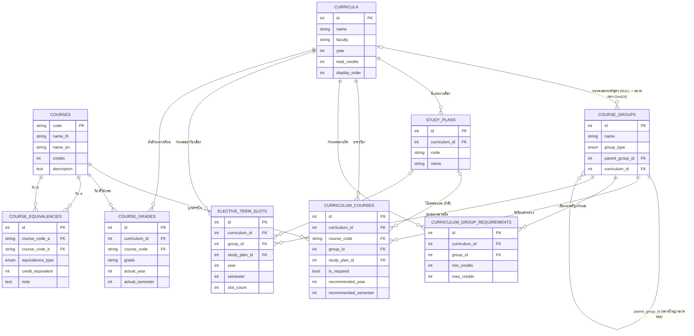

# โครงสร้างฐานข้อมูล — ระบบจัดการข้อมูลหลักสูตรปริญญาตรี

> **แหล่งอ้างอิง (source of truth): `models.py`**
> เอกสารเวอร์ชันนี้ (v2) **ตรวจเทียบกับ `models.py` ทีละบรรทัดแล้ว** หลังจากที่ v1 ถอดกลับจาก `seed_datay.py`
> เพียงไฟล์เดียวและมีข้อคลาดเคลื่อน — ดูสรุปการแก้ไขในหัวข้อที่ 2

**สถาปัตยกรรม:** SQLAlchemy 2.0 (Declarative + `Mapped` / `mapped_column`) → 9 ตาราง
**ฐานข้อมูล:** ไม่ผูกกับ vendor (ใช้ `Base.metadata.create_all()`) — ดู DDL ใน `database/db_schema.sql`

---

## 1. ภาพรวมตาราง

| ลำดับ | ตาราง (`__tablename__`) | คลาส | บทบาท | แถวจาก seed |
|---|---|---|---|---|
| 1 | `curricula` | `Curriculum` | หลักสูตร | **3** |
| 2 | `courses` | `Course` | คลังรายวิชากลาง (PK = รหัสวิชา) | หลักร้อย (ดูข้อ 7) |
| 3 | `course_groups` | `CourseGroup` | หมวด/หมวดย่อย (self-referencing tree) | **23** |
| 4 | `study_plans` | `StudyPlan` | แผนทางเลือกในหลักสูตรเดียว | **6** |
| 5 | `curriculum_courses` | `CurriculumCourse` | วิชา ↔ หมวด ↔ หลักสูตร ↔ แผน + ปี/เทอม | หลักหลายร้อย |
| 6 | `curriculum_group_requirements` | `CurriculumGroupRequirement` | หน่วยกิตขั้นต่ำ/สูงสุดต่อหมวด | **25** |
| 7 | `elective_term_slots` | `ElectiveTermSlot` | จำนวน "ช่อง" วิชาเลือกต่อหมวด/เทอม/แผน | **26** |
| 8 | `course_grades` | `CourseGrade` | ผลการเรียนที่ได้จริง (ผู้ใช้คนเดียว) | **0** (seed ไม่แตะ) |
| 9 | `course_equivalencies` | `CourseEquivalency` | คู่วิชาเทียบเคียงข้ามหลักสูตร | **110** |

ตัวเลขที่ทำ **หนา** คือยืนยันด้วยการนับจากโค้ดจริงในไฟล์ที่แนบมา (ดูหัวข้อ 7)

---

## 2. สรุปการแก้ไขจาก v1 → v2 (จุดที่ v1 เดาผิด)

| ประเด็น | v1 (เดาจาก seed) | v2 (ยืนยันจาก `models.py`) |
|---|---|---|
| จำนวนตาราง | 8 | **9** — ลืม `course_grades` |
| ชื่อตาราง | เอกพจน์ `curriculum`, `course`, ... | **พหูพจน์ทั้งหมด** `curricula`, `courses`, `course_groups`, `study_plans`, `curriculum_courses`, `curriculum_group_requirements`, `elective_term_slots`, `course_grades`, `course_equivalencies` |
| FK ไปหมวดแม่ | `parent_id` | **`parent_group_id`** |
| `courses.credits` | `numeric(4,1)` | **`Integer`** |
| `curricula.total_credits` | `numeric(5,1)` | **`Integer`** |
| `curricula.faculty` | NOT NULL | **nullable** |
| คอลัมน์ที่ตกไป | — | `courses.description` (Text), `curriculum_group_requirements.max_credits`, `course_equivalencies.credit_equivalent` |
| `course_equivalencies.note` | `varchar(255)` | **`Text`** |
| `EquivalenceType` | เดาว่ามีแค่ `FULL` | **มี `FULL` + `PARTIAL`** |
| UNIQUE ของ `curriculum_courses` | `(curriculum_id, course_code)` | **(curriculum_id, course_code, group_id, study_plan_id)** |
| UNIQUE ของ `elective_term_slots` | เขียนเองแบบ `COALESCE(...,0)` | **(curriculum_id, group_id, study_plan_id, year, semester)** แบบตรง ๆ |
| `elective_term_slots.slot_count` | `>= 0` | **`> 0`** (`ck_elective_slot_count_positive`) |
| ON DELETE ของ FK ไป `courses`/`course_groups` | RESTRICT | **CASCADE** ทุกตัว |
| `curr_group_requirements.min_credits` | `numeric(4,1)` | **`Integer`** (default 0, ไม่ใช่ DB default) |
| Index | เดาใส่ให้หลายตัว | **ของจริงมีแค่ PK + UNIQUE** — ที่เหลือเป็นข้อเสนอ (ดูข้อ 8) |
| Row count: คู่วิชาเทียบเคียง | 89 | **110** (34 คู่ Physics↔IoT + 76 คู่ ComIoT↔IoT) |
| Row count: ช่องวิชาเลือก | 28 | **26** (IoT 11 + ComIoT 7 + Physics 8) |

**สิ่งที่ v1 เดาถูกและยืนยันแล้ว:** ค่า `GroupType` ครบ 5 ค่า, กลไก `curriculum_id = NULL` = หมวดกลาง (GenEd), `study_plan_id = NULL` = ใช้ร่วมทุกแผน, `credits = 0` มีจริง, `semester = 3` = ภาคฤดูร้อน, ComIoT ไม่มี study plan, และ `CHECK course_code_a <> course_code_b`

---

## 3. แผนภาพ ER



---

## 4. ตาราง: คอลัมน์ตรงตาม `models.py`

### 4.1 `curricula` — หลักสูตร

| คอลัมน์ | ชนิด (SQLAlchemy) | Null | ค่าตั้งต้น | หมายเหตุ |
|---|---|---|---|---|
| `id` | Integer | PK | autoincrement | |
| `name` | String(255) | NOT NULL | | ชื่อเต็มรวม "หลักสูตรปรับปรุง พ.ศ. ..." |
| `faculty` | String(255) | **nullable** | | `คณะวิทยาศาสตร์` / `คณะวิศวกรรมศาสตร์` |
| `year` | Integer | NOT NULL | | ปี พ.ศ. = 2569 |
| `total_credits` | Integer | NOT NULL | | 122 / 138 / 118 |
| `display_order` | Integer | NOT NULL | `0` (Python-side) | IoT=1, ComIoT=2, Physics=3 |

> `total_credits` เป็น `Integer` → หลักสูตรที่หน่วยกิตไม่ลงตัว (เช่น 122.5) จะเก็บไม่ได้

### 4.2 `courses` — คลังรายวิชากลาง

| คอลัมน์ | ชนิด | Null | หมายเหตุ |
|---|---|---|---|
| `code` | String(20) | **PK** | เช่น `05366022`, `01236630`, `90644071` |
| `name_th` | String(255) | NOT NULL | |
| `name_en` | String(255) | nullable | |
| `credits` | Integer | NOT NULL | **`0` มีจริง** (ฝึกงาน/สัมมนา) |
| `description` | Text | nullable | seed ไม่เคยใส่ค่า |

Relationship: `curriculum_links` → `CurriculumCourse`, cascade `all, delete-orphan` (ระดับ ORM)
**ตารางนี้ไม่มี `__table_args__` เลย** → ไม่มี CHECK/UNIQUE ใด ๆ ในระดับ DB

### 4.3 `course_groups` — หมวดวิชา (tree)

| คอลัมน์ | ชนิด | Null | หมายเหตุ |
|---|---|---|---|
| `id` | Integer | PK | |
| `name` | String(255) | NOT NULL | |
| `group_type` | `Enum(GroupType)` | NOT NULL | เก็บเป็นชื่อ member = ค่าเดียวกัน |
| `parent_group_id` | Integer → `course_groups.id` | nullable, ON DELETE CASCADE | **NULL = หมวดใหญ่ระดับบนสุด** |
| `curriculum_id` | Integer → `curricula.id` | nullable, ON DELETE CASCADE | **NULL = หมวดกลางของสถาบัน (GenEd) ใช้ร่วมทุกหลักสูตร** |

Relationships: `parent`/`children` (self-ref, `remote_side="CourseGroup.id"`, cascade `all, delete-orphan`), `curriculum`, `curriculum_courses`, `requirements` (cascade `all, delete-orphan`)

**Tree ที่ seed สร้างจริง (23 กลุ่ม)**

```
[หมวดกลาง curriculum_id = NULL]  4 กลุ่ม
หมวดวิชาศึกษาทั่วไป
├── กลุ่มทักษะส่งเสริมอัตลักษณ์สถาบันฯ
├── กลุ่มวิชาเลือกด้านภาษาและการสื่อสาร
└── กลุ่มวิชาเลือกหมวดวิชาศึกษาทั่วไป

[Physics]  6 กลุ่ม — หมวดวิชาเฉพาะ → {พื้นฐาน, บังคับ, เลือก, ศึกษาทางเลือก} + หมวดวิชาเลือกเสรี(ไม่มี parent)
[IoT]      8 กลุ่ม — หมวดวิชาเฉพาะ → {พื้นฐานคณิตศาสตร์และวิทยาศาสตร์, พื้นฐานทางวิศวกรรม,
                                    บังคับ, บังคับเลือก, เลือกเฉพาะสาขา, ศึกษาทางเลือก}
                    + หมวดวิชาเลือกเสรี(ไม่มี parent)
[ComIoT]   5 กลุ่ม — หมวดวิชาเฉพาะ → {พื้นฐาน, บังคับ, เลือกเฉพาะสาขา} + หมวดวิชาเลือกเสรี(ไม่มี parent)
```

> วิชากลุ่ม "ทักษะบุคคลและส่งเสริมวิชาชีพ" และ "ทักษะการจัดการและภาวะความเป็นผู้นำ" ใน seed ถูกผูกเข้า
> `gened_elective` โดยตรง — **ไม่ได้สร้าง CourseGroup ย่อยจริง** ชื่อทั้งสองจึงเป็นแค่หัวข้อในโค้ด

### 4.4 `study_plans` — แผนทางเลือก

| คอลัมน์ | ชนิด | Null | หมายเหตุ |
|---|---|---|---|
| `id` | Integer | PK | |
| `curriculum_id` | Integer → `curricula.id` | NOT NULL, CASCADE | |
| `code` | String(50) | NOT NULL | `PROJECT` / `COOP` / `OVERSEA_TRAINING` |
| `name` | String(255) | NOT NULL | `แผนทำโครงงานพิเศษ` / `แผนสหกิจศึกษา` / `แผนฝึกงานต่างประเทศ` |

**UNIQUE: `uq_study_plan_code` = (curriculum_id, code)**
seed: Physics 3 + IoT 3 + ComIoT 0 = **6 แถว**

### 4.5 `curriculum_courses` — ตารางเชื่อมหลัก

| คอลัมน์ | ชนิด | Null | หมายเหตุ |
|---|---|---|---|
| `id` | Integer | PK | |
| `curriculum_id` | Integer → `curricula.id` | NOT NULL, CASCADE | |
| `course_code` | String(20) → `courses.code` | NOT NULL, CASCADE | |
| `group_id` | Integer → `course_groups.id` | NOT NULL, CASCADE | หมวดที่วิชานี้สังกัด **ในหลักสูตรนี้** |
| `study_plan_id` | Integer → `study_plans.id` | **nullable**, CASCADE | NULL = ใช้ร่วมทุกแผน |
| `is_required` | Boolean | NOT NULL | default `True` (Python-side) |
| `recommended_year` | Integer | nullable | seed ใช้ 1–4 (ไม่มี CHECK) |
| `recommended_semester` | Integer | nullable | 1/2/3 |

**Constraints:**
- `uq_curriculum_course_group_plan` = **UNIQUE (curriculum_id, course_code, group_id, study_plan_id)**
- `ck_recommended_semester_valid` = `recommended_semester IN (1, 2, 3)` *(NULL ผ่านได้ เพราะ SQL ถือว่า unknown ไม่ใช่ false)*

### 4.6 `curriculum_group_requirements` — หน่วยกิตขั้นต่ำ/สูงสุด

| คอลัมน์ | ชนิด | Null | หมายเหตุ |
|---|---|---|---|
| `id` | Integer | PK | |
| `curriculum_id` | Integer | NOT NULL, CASCADE | |
| `group_id` | Integer | NOT NULL, CASCADE | |
| `min_credits` | Integer | NOT NULL | default `0` (Python-side) |
| `max_credits` | Integer | **nullable** | **seed ไม่เคยใช้** |

**UNIQUE: `uq_curriculum_group_requirement` = (curriculum_id, group_id)**

ตัวเลขจริง 25 แถว — ผลบวกของทุกหมวด = หน่วยกิตรวมของหลักสูตรพอดี:

| หมวด | Physics (122) | IoT (138) | ComIoT (118) |
|---|---|---|---|
| กลุ่มอัตลักษณ์สถาบันฯ | 12 | 12 | 12 |
| ภาษาและการสื่อสาร | 3 | 3 | 3 |
| วิชาเลือกศึกษาทั่วไป | 9 | 9 | 9 |
| พื้นฐาน | 18 | — | 19 |
| พื้นฐานคณิตศาสตร์และวิทยาศาสตร์ | — | 23 | — |
| พื้นฐานทางวิศวกรรม | — | 13 | — |
| วิชาบังคับ | 59 | 51 | 57 |
| วิชาเลือก | 9 | — | — |
| วิชาบังคับเลือก | — | 6 | — |
| วิชาเลือกเฉพาะสาขา | — | 9 | 12 |
| ศึกษาทางเลือก | 6 | 6 | — |
| วิชาเลือกเสรี | 6 | 6 | 6 |
| **รวม** | **122** | **138** | **118** |
| จำนวนแถว | 8 | 10 | 7 |

> หมายเหตุจากไฟล์ seed เอง: การจัด "หมวดย่อยต่อรายวิชา" เป็นการประมาณของผู้จัดทำ แต่ `min_credits` อ้างจากเอกสารหลักสูตรจริง

### 4.7 `elective_term_slots` — จำนวนช่องวิชาเลือก

| คอลัมน์ | ชนิด | Null | หมายเหตุ |
|---|---|---|---|
| `id` | Integer | PK | |
| `curriculum_id` | Integer | NOT NULL, CASCADE | |
| `group_id` | Integer | NOT NULL, CASCADE | |
| `study_plan_id` | Integer | nullable, CASCADE | NULL = ใช้ร่วมทุกแผน |
| `year` | Integer | NOT NULL | |
| `semester` | Integer | NOT NULL | |
| `slot_count` | Integer | NOT NULL | default `1` (Python-side) |

**Constraints:**
- `uq_elective_term_slot` = **UNIQUE (curriculum_id, group_id, study_plan_id, year, semester)**
- `ck_elective_slot_semester_valid` = `semester IN (1, 2, 3)`
- `ck_elective_slot_count_positive` = **`slot_count > 0`**

seed **26 แถว**: IoT 11 (มี `study_plan_id` 6 แถว), Physics 8 (NULL ทั้งหมด), ComIoT 7 (NULL ทั้งหมด)
ตรรกะ: แผน PROJECT ของ IoT เรียนวิชาเลือกเฉพาะสาขา ปี 4 เทอม 1 จำนวน 2 ช่อง + เทอม 2 จำนวน 1 ช่อง
ส่วนแผน COOP/OVERSEA ไม่มีวิชาเลือกในเทอม 1 แต่ไปรวมที่เทอม 2 จำนวน 3 ช่อง

### 4.8 `course_grades` — ผลการเรียนรายวิชา  ⚠️ **v1 ตกไปทั้งตาราง**

| คอลัมน์ | ชนิด | Null | หมายเหตุ |
|---|---|---|---|
| `id` | Integer | PK | |
| `curriculum_id` | Integer | NOT NULL, CASCADE | |
| `course_code` | String(20) | NOT NULL, CASCADE | |
| `grade` | String(2) | NOT NULL | ตามคอมเมนต์: `A, B+, B, C+, C, D+, D, F, S, U` |
| `actual_year` | Integer | nullable | ปีที่เรียนจริง (ต่างจาก `recommended_year` ได้) |
| `actual_semester` | Integer | nullable | |

**UNIQUE: `uq_course_grade_curriculum_course` = (curriculum_id, course_code)**

- **seed ไม่แตะตารางนี้เลย** → 0 แถว
- คอมเมนต์ในโมเดลระบุชัดว่า **ยังไม่มี `Student` entity** = ระบบรองรับผู้ใช้คนเดียว
- ไม่มี CHECK ตรวจค่าเกรดที่ถูกต้อง

### 4.9 `course_equivalencies` — คู่วิชาเทียบเคียง

| คอลัมน์ | ชนิด | Null | หมายเหตุ |
|---|---|---|---|
| `id` | Integer | PK | |
| `course_code_a` | String(20) → `courses.code` | NOT NULL, CASCADE | |
| `course_code_b` | String(20) → `courses.code` | NOT NULL, CASCADE | |
| `equivalence_type` | `Enum(EquivalenceType)` | NOT NULL | default `FULL` |
| `credit_equivalent` | Integer | **nullable** | ใช้เมื่อ `PARTIAL` — **seed ไม่เคยใช้** |
| `note` | **Text** | nullable | seed ใส่ข้อความยาวได้ |

**Constraints:**
- `ck_equivalency_not_self` = `course_code_a != course_code_b`
- **ไม่มี UNIQUE** → `(a, b)` และ `(b, a)` เก็บซ้ำได้ (ดูข้อ 8)

Relationships: `course_a` / `course_b` แยกด้วย `foreign_keys=[...]`
seed **110 แถว** ทั้งหมดเป็น `FULL`: ชุด Physics↔IoT 34 คู่ (`a` = รหัส IoT, `b` = รหัส Physics) + ชุด ComIoT↔IoT 76 คู่ (`a` = `01446xxx`, `b` = `01236xxx`)

---

## 5. Enum

| Enum | ค่า | ใช้ที่คอลัมน์ | หมายเหตุ |
|---|---|---|---|
| `GroupType` | `GENED`, `MAJOR_REQUIRED`, `MAJOR_ELECTIVE`, `RESTRICTED_ELECTIVE`, `FREE_ELECTIVE` | `course_groups.group_type` | ครบทั้ง 5 ค่าถูกใช้จริง |
| `EquivalenceType` | `FULL`, `PARTIAL` | `course_equivalencies.equivalence_type` | seed ใช้แค่ `FULL` |
| `SemesterType` | `FIRST=1`, `SECOND=2`, `SUMMER=3` | — | ⚠️ **ประกาศไว้แต่ไม่ถูกใช้ที่ไหนเลย** (ตาย) — เทอมใช้ `Integer` + CHECK แทน |

**การเก็บค่า:** `SAEnum` ไม่ได้ตั้ง `values_callable` → SQLAlchemy เก็บ **ชื่อ member** ซึ่งในที่นี้เท่ากับค่าอยู่แล้ว
บน PostgreSQL (`native_enum=True` เป็นค่าเริ่มต้น) จะได้ **native ENUM** ชื่อ type อ้างจากชื่อ class ของ enum
(โดยทั่วไปคือ `grouptype` และ `equivalencetype`) ส่วน SQLite จะได้ `VARCHAR` + `CHECK ... IN (...)`

---

## 6. ความสัมพันธ์แบบย่อ

```
curricula ─┬─< course_groups (curriculum_id NULL = หมวดกลาง GenEd แชร์ทุกหลักสูตร)
           ├─< study_plans
           ├─< curriculum_courses >── courses
           │                       └── course_groups
           │                       └── study_plans (NULL = ใช้ร่วมทุกแผน)
           ├─< curriculum_group_requirements >── course_groups
           ├─< elective_term_slots >── course_groups / study_plans
           └─< course_grades >── courses

courses ─< course_equivalencies (a ↔ b, ไม่มีทิศทาง)
course_groups ─< course_groups (ผ่าน parent_group_id)
```

**ON DELETE: CASCADE ทุก FK ที่ประกาศในระดับ DB** (มีเฉพาะ FK เท่านั้น ส่วน `Course.curriculum_links`,
`CourseGroup.children`, `Curriculum.groups`, `Curriculum.courses`, `CourseGroup.requirements` เป็น
`delete-orphan` ระดับ ORM ซึ่งทำงานเมื่อลบผ่าน session เท่านั้น)

ผลข้างเคียงที่ควรรู้: ลบ 1 `courses` → ลบ `curriculum_courses`, `course_grades`, `course_equivalencies` ของวิชานั้นทั้งหมด
และลบ `course_groups` 1 กลุ่ม → ลบหมวดย่อยที่ `parent_group_id` ชี้มา รวมทั้ง `curriculum_courses` ที่ผูกกับกลุ่มนั้น

---

## 7. ข้อมูลที่ seed ใส่จริง (ยืนยันจากการนับในโค้ด)

| ตาราง | จำนวน | ที่มา |
|---|---|---|
| `curricula` | 3 | Physics 122 / IoT 138 / ComIoT 118 |
| `course_groups` | 23 | gened 4 + physics 6 + iot 8 + comiot 5 |
| `study_plans` | 6 | physics 3 + iot 3 |
| `curriculum_group_requirements` | 25 | 8 + 10 + 7 (ผลบวกรวม = 122/138/118 พอดี) |
| `course_equivalencies` | 110 | 34 + 76 |
| `elective_term_slots` | 26 | iot 11 + comiot 7 + physics 8 |
| `course_grades` | 0 | seed ไม่แตะ |
| `courses` | หลักร้อย | 9 (GenEd พิเศษ) + ค่าจาก 4 บล็อก RAW + วิชาเฉพาะ 3 หลักสูตร — นับจริงด้วย `session.query(Course).count()` |
| `curriculum_courses` | หลักหลายร้อย | GenEd 1 วิชา × 3 หลักสูตร = 3 แถว (บวกค่า override ที่ข้าม/สลับเทอม) |

หลักสูตร: **ฟิสิกส์อุตสาหกรรม** (วท.บ., 122) / **วิศวกรรมระบบไอโอทีและสารสนเทศ** (วศ.บ., display_order 1, 138) / **วิศวกรรมคอมพิวเตอร์และไอโอที (ต่อเนื่อง)** (วศ.บ., 118)

---

## 8. ข้อสังเกตเชิงออกแบบ / ความเสี่ยงที่ควรตรวจ

### 8.1 ปัญหาเชิงโครงสร้าง

1. **UNIQUE ที่มี NULL = ไม่ป้องกันของจริง** — `UNIQUE(...)` ของ `curriculum_courses` และ `elective_term_slots` มี `study_plan_id` อยู่ด้วย และตามมาตรฐาน SQL **NULL ถือว่าไม่ซ้ำกัน** → แถวที่ `study_plan_id IS NULL` (ซึ่งคือกลุ่มที่ใช้ร่วมทุกแผน = กลุ่มใหญ่ที่สุด) **ใส่ซ้ำได้ไม่จำกัด** ควรเพิ่ม partial unique index:
   ```sql
   CREATE UNIQUE INDEX uq_cc_shared ON curriculum_courses (curriculum_id, course_code, group_id)
     WHERE study_plan_id IS NULL;
   CREATE UNIQUE INDEX uq_ets_shared ON elective_term_slots (curriculum_id, group_id, year, semester)
     WHERE study_plan_id IS NULL;
   ```
2. **ไม่มี Index บน FK เลย** — `create_all()` สร้างแค่ PK (+ UNIQUE ที่ประกาศ) เท่านั้น FK ทุกตัวไม่มี index อัตโนมัติทั้งใน SQLite และ PostgreSQL → query ที่ join/filter ด้วย `curriculum_id`, `course_code`, `group_id`, `study_plan_id` จะสแกนตารางเต็ม ควรเพิ่ม index (อยู่ในไฟล์ `.sql` ให้แล้ว)
3. **`course_equivalencies` ไม่มี UNIQUE** — เป็นความสัมพันธ์สมมาตรที่เก็บด้านเดียว แต่ DB ไม่กัน `(b, a)` ซ้ำหรือ `(a, b)` ซ้ำ ต้องมีวินัยระดับแอป (หรือเพิ่ม unique บน `LEAST/GREATEST(a,b)` สำหรับ PG)
4. **ไม่มี CHECK ว่าค่าในตารางต้องสอดคล้องกัน** — เช่น ไม่มีอะไรบังคับว่า `curriculum_courses.group_id` ต้องเป็นหมวดของ `curriculum_id` เดียวกัน (หรือเป็นหมวดกลาง `curriculum_id IS NULL`) และไม่มีอะไรกัน `study_plan_id` ที่เป็นของหลักสูตรอื่น
5. **CHECK ผ่านเมื่อค่าเป็น NULL** — `recommended_semester IN (1,2,3)` และ `semester IN (1,2,3)` จะไม่ error ถ้าเป็น NULL (ข้อหลังเป็น NOT NULL จึงไม่กระทบ แต่ข้อแรกเป็น nullable จริง)
6. **`group_type` ของหมวดแม่กับหมวดลูกไม่จำเป็นต้องตรงกัน** — root `หมวดวิชาเฉพาะ` เป็น `MAJOR_REQUIRED` แต่ลูกมีทั้ง `MAJOR_ELECTIVE`/`RESTRICTED_ELECTIVE` → ตรรกะควรยึด type ของกลุ่มที่ผูกกับวิชาโดยตรง
7. **`หมวดวิชาเลือกเสรี` เป็นหมวดบนสุดที่ไม่มี parent** ต่างจากหมวดวิชาเฉพาะที่มี root → ต้องระวังตอนวาด tree/normalize

### 8.2 ข้อจำกัดเชิงขอบเขต (โดยเจตนา)

8. **`course_grades` ผูกกับ "ผู้ใช้คนเดียว"** — ไม่มี `Student` entity และ UNIQUE `(curriculum_id, course_code)` = 1 วิชาเก็บได้เกรดเดียว → **รองรับการเรียนซ้ำ/สอบซ่อมไม่ได้** (เก็บได้แค่ผลสุดท้าย) และรองรับนักศึกษาหลายคนไม่ได้ ถ้าจะทำเป็นระบบจริงต้องเพิ่ม `student_id` แล้วเปลี่ยน unique เป็น `(student_id, curriculum_id, course_code)`
9. **หน่วยกิตเป็น `Integer` ทั้งหมด** (`courses.credits`, `curricula.total_credits`, `min_credits`) → หน่วยกิตแบบมีทศนิยม (เช่น 2.5) เก็บไม่ได้ ถ้ามีในอนาคตต้องเปลี่ยนชนิด
10. **ยังไม่มี** วิชาบังคับก่อน (prerequisite), อาจารย์ผู้รับผิดชอบ, ปีการศึกษาที่เปิดสอนจริง, การลงทะเบียน — โครงนี้เป็น "โครงสร้างหลักสูตร + ผลการเรียน" ไม่ใช่ระบบทะเบียน
11. **`max_credits` กับ `credit_equivalent` มีในโมเดลแต่ไม่มีข้อมูลและไม่มีโค้ดใช้** → เป็น field ที่ออกแบบเผื่อไว้ ถ้าไม่ใช้ควรพิจารณาตัดออกเพื่อลดความสับสน

### 8.3 ความไม่สอดคล้องของเอกสารในโค้ด (drift)

12. **docstring ของ `models.py` ล้าสมัย** — ระบุว่ามี 6 ตาราง แต่มีคลาสจริง 9 ตาราง (ขาด `StudyPlan`, `ElectiveTermSlot`, `CourseGrade`)
13. **docstring ของ `seed_datay.py` ล้าสมัย** — เขียนว่า "ปีที่ 4 มีแผนทางเลือก (StudyPlan) 2 แบบ" แต่โค้ดสร้าง **3 แผน** (`PROJECT`, `COOP`, `OVERSEA_TRAINING`)
14. **ชื่อไฟล์ `seed_datay.py`** ไม่ตรงกับบรรทัดแรกของ docstring ที่เขียนว่า `seed_data.py` (น่าจะสะกดผิด) — ถ้ามีการ import ด้วยชื่อโมดูลจะกระทบ
15. **`SemesterType` ประกาศแล้วไม่ใช้** → ทางเลือกคือเลิกใช้ถาวร หรือทำให้เทอม 1/2/3 อ้างจาก enum เพื่อไม่ให้ค่าลอย ๆ กระจัดกระจาย
16. **`default=` ในโมเดลเป็น Python-side ไม่ใช่ DB DEFAULT** (`display_order=0`, `is_required=True`, `min_credits=0`, `slot_count=1`, `equivalence_type=FULL`) → ถ้า INSERT ด้วย SQL ตรง ๆ คอลัมน์ `NOT NULL` เหล่านี้ **ไม่ได้รับค่าอัตโนมัติ** ต้องระบุเอง

---

## 9. ไฟล์ที่เกี่ยวข้อง

- `database/db_schema.sql` — DDL ที่ตรงกับ `models.py` (พหูพจน์, `parent_group_id`, enum ครบ) พร้อม index ที่แนะนำ
  ⚠️ **ถ้าแอปใช้ `Base.metadata.create_all()` อยู่แล้ว ไม่ต้องรันไฟล์นี้** (จะได้ตาราง/type ซ้ำ)
